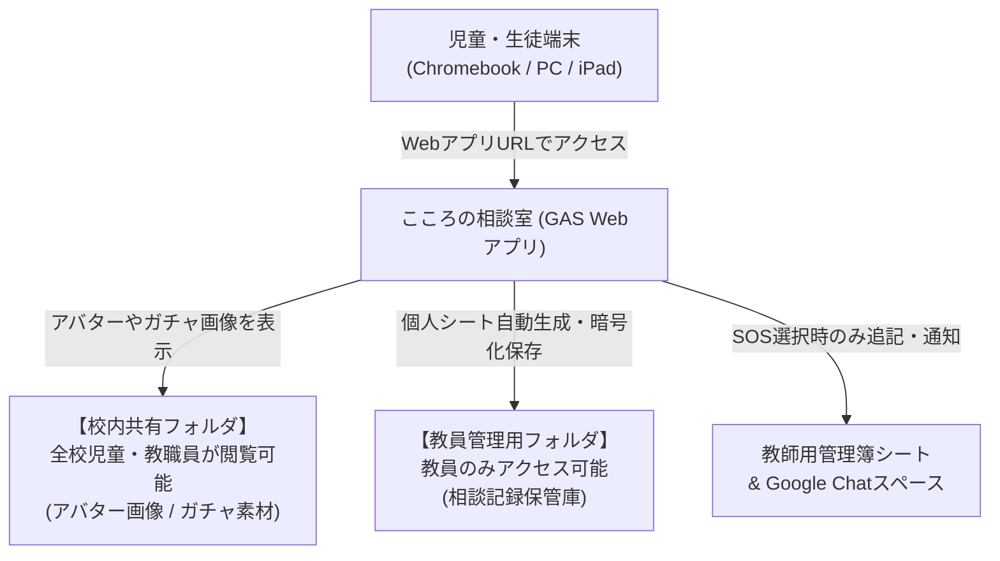
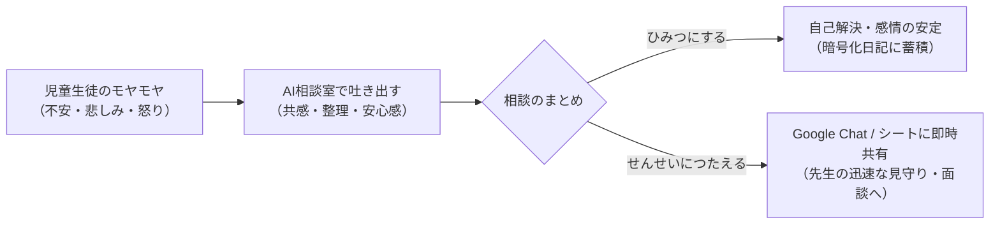

# 『こころの相談室』他校導入・初期設定マニュアル

本書は、Google Apps Script (GAS) Webアプリケーション『こころの相談室』を他校のGoogle Drive環境にコピーし、ゼロから安全にセットアップして利用開始するための公式手順書です。  
学校のセキュリティポリシー（組織外への公開制限等）に準拠し、プログラミングの専門知識がない先生でも迷わず導入できるように構成されています。

---

## 1. 全体像と事前準備

### 1.1 システムの構成概要
本システムは、学校ですでに導入されている **Google Workspace for Education 環境（Google Drive / スプレッドシート）と Google Gemini API のみ** で動作します。



### 1.2 事前に準備するもの
導入前に以下の4点をご用意ください：

| 準備するもの | 説明 | 備考 |
| :--- | :--- | :--- |
| **Google アカウント** | 管理・導入作業を行う先生のアカウント | Google Workspace for Education |
| **Gemini API キー** | Google AI Studio で発行するAPIキー | 後述のステップで無料で取得可能 |
| **Google Chat スペース** | SOS通知を受信する職員用スペース | 通知を希望する場合のみ（任意） |
| **画像素材（アバター・ガチャ）** | アバター画像（25枚）とガチャカード（120枚） | 配布パッケージ内の共有フォルダからコピー |

---

## 2. セットアップ手順（5ステップ）

### ステップ 1: Google Driveに「校内共有フォルダ」と「教員管理用フォルダ」を用意する

学校のセキュリティポリシーを遵守し、**「全校児童に見せるフォルダ」** と **「教員のみが管理するフォルダ」** の2つに分けて作成します。

```
Google Drive
├── 📁 こころの相談室_公開素材 【校内共有フォルダ：全校児童・教員が閲覧可能】
│   ├── 📁 アバター画像 (25枚のWebP)
│   ├── 📁 ガチャ画像 (スーパーレア/レア/コモン)
│   └── 📊 ガチャマスター (スプレッドシート)
│
└── 📁 こころの相談室_システム管理 【教員管理用フォルダ：教員のみアクセス】
    ├── 📁 相談記録保管庫 (児童ごとの暗号化シートが自動生成される場所)
    ├── 📊 こころの相談室_教師用管理簿 (児童情報・児童より)
    └── ⚙️ こころの相談室_システム (GASプロジェクト)
```

---

#### A. 【校内共有フォルダ】の作成（全校児童・教職員が閲覧可能）

1. Google Drive で新規フォルダ **「こころの相談室_公開素材」** を作成します。
2. 作成したフォルダを右クリック ＞ **【共有】** をクリックします。
3. **一般的なアクセス**で **【（自校の組織名）の全員】**（または全校児童・教職員グループ）を選択し、権限を **【閲覧者】** に設定して保存します。
   > [!NOTE]
   > 自治体や学校の制限で「リンクを知っている全員（インターネット全体）」への共有が禁止されている場合でも、この「学校内の全員に閲覧者」設定であれば安全に画像が表示されます。
4. このフォルダの中に、以下を配置します：
   * **アバター画像フォルダ**: 配布された25種類のWebP画像を保存します。
     * ➜ **アバター画像フォルダのIDをメモします**: フォルダを開いたURL `https://drive.google.com/drive/folders/【この部分の英数字】`
   * **（任意）ガチャ画像フォルダ**: スーパーレア/レア/コモンの3つのフォルダをそのまま保存します。
     * ➜ **ガチャ画像フォルダのIDをメモします**。
   * **（任意）ガチャマスタースプレッドシート**: 配布されたスプレッドシートを保存します。
     * ➜ **ガチャマスタースプレッドシートのIDをメモします**: URL `https://docs.google.com/spreadsheets/d/【この部分の英数字】/edit`

---

#### B. 【教員管理用フォルダ】の作成（教員・システム担当者のみ）

> [!CAUTION]
> **🚨【最重要・厳重注意】プログラム（GASプロジェクト）の保存場所について**  
> 本システムは、**「Google Drive上でプログラム本体（GASプロジェクト）または教員管理フォルダに編集権限を持つアカウント（先生）」だけが管理画面を開けるゼロパスワード設計**になっています。  
> したがって、**スクリプト本体（`こころの相談室_システム`）は、必ずこの「教員管理用フォルダ」（または教職員専用の共有ドライブ）内に作成・保存してください。**  
> ⚠️ **絶対にやってはいけないこと：**  
> 全校児童が閲覧できる「校内共有フォルダ（公開素材フォルダ等）」の中にスクリプトを作成・移動しないでください。児童にも編集権限が及んでしまい、管理画面を操作される危険が生じます。

1. Google Drive で新規フォルダ **「こころの相談室_システム管理」** を作成します。
   * ※**教職員専用の共有ドライブ内**に作成するか、教職員アカウントのみに共有し、**児童生徒には一切共有しないでください**。
2. このフォルダの中に、以下を作成・配置します：

##### ① 相談記録の保存フォルダ
* フォルダ名: `相談記録保管庫`
* 役割: 相談した児童ごとに、暗号化された個人シートが自動生成される場所です。
* **フォルダIDをメモします**。

##### ② 教師用スプレッドシート
* スプレッドシートを新規作成し、ファイル名を `こころの相談室_教師用管理簿` にします。
* シート名を以下の通り2枚作成します：
  1. シート『**児童情報**』
     * 1行目（ヘッダー）に左から順に以下を入力します：  
       `A1: メールアドレス` / `B1: 学年` / `C1: 組` / `D1: 出席番号` / `E1: 氏名` / `F1: ふりがな` / `G1: 予備` / `H1: 表示名（ニックネーム）`
     * 2行目以降に、利用する児童の情報を登録します（※A列のメールアドレスとH列のニックネームが重要です）。
  2. シート『**児童より**』
     * 1行目（ヘッダー）に左から順に以下を入力します：  
       `A1: 日時` / `B1: メールアドレス` / `C1: 学年` / `D1: 組` / `E1: 番号` / `F1: 氏名` / `G1: 相談要約`
* **スプレッドシートIDをメモします**。

##### ③ システムプログラム本体（GASプロジェクト）
* この「こころの相談室_システム管理」フォルダ内で、新規 ＞ **【その他】** ＞ **【Google Apps Script】** をクリックして作成します。
* プロジェクト名: `こころの相談室_システム`

---

### ステップ 2: Gemini API キーを取得する

1. ブラウザで [Google AI Studio](https://aistudio.google.com/) にアクセスします。
2. 画面左上の **【Get API key】** をクリックします。
3. **【Create API key】** をクリックし、作成された文字列（`AIzaSy...` から始まるキー）をコピーして大切に保管します。

> [!CAUTION]
> **APIキーの取り扱い**  
> APIキーは学校のシステム専用の鍵です。児童や外部の人に教えたり、公開ウェブサイトに掲載しないでください。

---

### ステップ 3: スクリプトをプロジェクトに配置する

1. Google Drive の **「こころの相談室_システム管理」** フォルダ内で、新規 ＞ **【その他】** ＞ **【Google Apps Script】** をクリックします。
2. プロジェクト名を「こころの相談室_システム」に変更します。
3. 本システムの全ファイル（`.js` および `.html`）をプロジェクト内に作成・貼り付けます（または clasp 等で一括配置）。
4. 上部の「実行する関数を選択」プルダウンから **`setupAppProperties`** を選択し、**【実行】** をクリックします。
   * 初回実行時、「アクセス権の承認」を求められるので、画面の指示に従ってご自身のアカウントを承認します。
   * ➜ 暗号化用秘密鍵（Pepper）と推奨モデル（`gemini-2.5-flash-lite`）が自動セットアップされます。
   > [!NOTE]
   > コード内（`Config.js` 等）に学校固有のIDを直接書き込む必要は一切ありません。すべての設定は次の管理画面から安全に行えます。

---

### ステップ 4: Webアプリケーションとして公開し、管理画面で初期設定を行う

1. GASエディタ右上の青いボタン **【デプロイ】** ＞ **【新しいデプロイ】** をクリックします。
2. 左側の歯車アイコンをクリックし、**【ウェブアプリ】** を選択します。
3. 以下の通り設定します：
   * **説明**: `v1.0 初期リリース`
   * **次のユーザーとして実行**: **【アクセスしているユーザー】**（※児童ごとのGoogleアカウントで安全に識別・暗号化するため）
   * **アクセスできるユーザー**: **【（自校の組織名）の全員】**
4. **【デプロイ】** をクリックします。
5. 画面に表示された **「ウェブアプリの URL」**（`https://script.google.com/macros/s/.../exec`）をコピーします。

#### 管理画面（設定パネル）での初期設定

1. コピーしたURLの末尾に `?view=admin` を付けてブラウザで開きます：  
   `https://script.google.com/macros/s/.../exec?view=admin`
2. 管理者ログイン画面が表示されたら、初期パスワード **`KokoroAdmin2026!`** を入力してログインします。
3. **「⚙️ システム設定」タブ** で、ステップ1・2でメモした各IDとAPIキーを入力し、**【💾 設定を保存する】** をクリックします：
   * ① 相談記録保管庫フォルダID
   * ② アバター画像フォルダID
   * ③ 教師用管理簿スプレッドシートID
   * ④ ガチャ画像フォルダID（任意）
   * ⑤ ガチャマスタースプレッドシートID（任意）
   * ⑥ Gemini APIキー
   * ⑦ Gemini モデル（推奨: `gemini-2.5-flash-lite` / 候補から選択または自由手入力）
   * ⑧ Google Chat Webhook URL（任意）
4. **「🔍 接続テスト・診断」タブ** を開き、**【🚀 診断テストを実行する】** をクリックします。
   * 全てのリソースが「正常」と表示されれば、初期設定はすべて完了です！
5. **「🔒 パスワード変更」タブ** で、初期パスワードを学校独自の安全なパスワードに変更してください。

> [!IMPORTANT]
> **管理者パスワードを忘れた場合の安全なリカバリー方法（マスター担当者不要）**  
> 万一パスワードを忘れた場合や、年度替わりで後任の先生に引き継ぐ際でも、特定個人にマスター権限を預ける必要はありません。  
> **Google Drive上でGASを開ける先生**がGASエディタを開き、ファイル `AdminService.js` の関数 **`resetAdminPassword`** を手動実行するだけで、初期パスワード（`KokoroAdmin2026!`）に安全にリセットできます。児童生徒はGASエディタの編集権限がないため悪用できません。

---

### ステップ 5: 児童・生徒への配付

通常アクセス用URL（末尾に `?view=admin` をつけない通常のウェブアプリURL）を児童・生徒へ配付します。

> [!TIP]
> **児童・生徒への配付方法**  
> コピーしたURLを、Google Classroom の「資料」として投稿するか、Chromebookの「Google 管理コンソール」からブックマーク配信・キオスク配信すると、児童が迷わずワンクリックで相談室にアクセスできます。

---

## 3. よくある質問・トラブルシューティング

| 症状・エラー | 原因 | 対処方法 |
| :--- | :--- | :--- |
| **「アバター画像が表示されない（🌱マークのまま）」**<br>**「ガチャ画像が？マークになる」** | 画像フォルダが全校児童・教職員に共有されていない | 学校のGoogle Drive内で、素材を格納している親フォルダ（`こころの相談室_公開素材`）の共有設定を開き、**【自校の組織名（〇〇学校の全員）】に【閲覧者】権限**が割り当てられているか確認してください。 |
| **「会話で通信エラーになる」** | `GEMINI_API_KEY` が未設定または無効 | プロジェクトの設定でスクリプトプロパティに正しいAPIキーが設定されているか確認してください。 |
| **「先生への通知が届かない」** | `CHAT_WEBHOOK` のURLが間違っている | Google Chatのスペース管理画面でWebhookを再作成し、スクリプトプロパティに再登録してください。 |
| **「児童の名前が表示されない」** | 『児童情報』シートのA列メールアドレスが不一致 | 児童がログインしているGoogleアカウントのメールアドレスと、スプレッドシートA列の記述が完全一致しているか確認してください。 |
| **「外部共有が制限されていて画像が共有できない」** | 自治体のセキュリティポリシーによる制限 | インターネット全体（「リンクを知っている全員」）に共有する必要はありません。**「学校内の全員に閲覧者」**権限を付与した校内共有フォルダに保存すれば、制限を回避して安全に表示されます。 |

<div style="page-break-before: always;"></div>

---

# 『こころの相談室』教師用機能説明・運用マニュアル

本書は、小学校・中学校・特別支援学校等の現場において、担任・養護教諭・スクールカウンセラー（SC）・管理職の先生方が『こころの相談室』を安心・安全に運用するためのガイドラインです。

---

## 1. アプリの目的と学校現場での位置づけ

### 1.1 開発の思いと基本方針
「誰にも言えない悩み」「先生や親に心配をかけたくないという遠慮」「言葉にしづらいモヤモヤ」を抱える児童生徒に対し、**GIGAスクール端末（Chromebook / iPad等）からいつでも安全にアクセスできる心理的セーフティネット**を提供します。

* **AIパートナーの役割**: 医療・診断や最終的な問題解決ではなく、**「まずは100%肯定・共感して孤立を防ぎ、気持ちを整理する」**ための存在です。
* **先生方の役割**: AIが児童の言葉を受け止め、児童自身が「先生に伝えよう」と決心した時に、**そのSOSを迅速かつ温かくキャッチして現実の支援につなげる**役割を担います。



---

## 2. 児童生徒側の利用フローと画面説明

児童がどのような手順でアプリを利用しているかを理解しておくことで、面談時の声かけがスムーズになります。

### ステップ 1: はじめの約束（利用ルール確認）
* アプリ起動時、最初に「うそはつかなくていいよ」「ふわふわ言葉を使おうね」「AIだから間違うこともあるよ」「秘密は守るよ」という安心のための約束画面が表示されます。

### ステップ 2: 今日の気分の選択
* 「うれしい」「ふつう」「かなしい」「おこってる」「つかれた」「ドキドキ」「モヤモヤ」の7つのボタンから、今の気持ちを直感的に選びます。
* AIは選ばれた気分に寄り添った最初の言葉がけを行います。

### ステップ 3: チャットによる対話
* **文字入力またはマイク入力**: キーボードタイピングだけでなく、音声入力（マイク）にも対応しています。
* **まほうのメニュー（🪄えらぶ）**: 「どうすればいい？」「いっしょにかんがえて」など、気持ちを言葉にするのが苦手な低学年の子でもワンタップで会話を進められます。
* **アバターの表情連動**: 児童の発言内容とAIの感情に合わせて、25種類のアバター表情がリアルタイムに変化します。
* **安全制御**: 1回の相談は最大20往復までに制限されており、長時間の画面凝視や依存を防ぎます。

### ステップ 4: 終了と振り返り（にっきの保存）
* 相談が終わると、AIが会話の要約（50文字以内の優しいひらがな文章）を自動生成します。
* 児童は「おわりのきもち」（すっきりした、まだかなしい等）を選び、ひとことメモを残して日記に保存します。

### ステップ 5: 先生への共有選択（重要）
* 最後に必ず以下の2者択一を行います：
  1. **【🔒 ひみつにして おわる】**: 相談内容は児童自身の暗号化シートにのみ保存され、先生には通知されません。
  2. **【📢 せんせいにも つたえる】**: 「こうちょう先生」「ほけんの先生」「たんにんの先生」など、伝えたい先生を選択して終了します。

---

## 3. 教師側での確認と対応フロー

児童が「📢 せんせいにも つたえる」を選択した場合、以下の2つの経路で情報が届きます。

### 3.1 Google Chat スペースでの即時SOS通知（設定している場合）
* 児童が送信した瞬間、設定した職員用スペースに通知カードが届きます。
* **通知内容**:
  * 学年・組・出席番号・氏名
  * 相談要約（AIが客観的にまとめた200文字程度の概要）
  * 希望する担当教員（例：「ほけんのせんせい」等）
  * 管理スプレッドシートへの直接リンクボタン

### 3.2 教師用スプレッドシート（『児童より』シート）の確認
1. 『こころの相談室_教師用管理簿』を開きます。
2. シート『**児童より**』を選択します。
3. 新しい相談が最新行に自動追記されています：
   * **日時**: 相談が完了した日時
   * **児童情報**: 学年、組、番号、氏名、メールアドレス
   * **相談概要**: AIが生成した客観的な要約文（話題の中心、感情の推移）

---

## 4. 児童のプライバシー保護とセーフティ基準

### 4.1 暗号化によるプライバシー保護
* 児童一人ひとりの相談ログは、児童個別のスプレッドシートに **AES（軍事レベルの暗号化規格）** で暗号化されて保存されます。
* 児童が「ひみつにする」を選んだ相談内容は、Google Driveの管理者であっても平文で勝手に盗み見ることはできません。児童が「ここは安全な場所だ」と心から信頼して本音を話せる環境を担保しています。

### 4.2 命の危険や虐待に関する絶対安全ルール（AIのプロンプト制限）
AIには、以下のような厳格なセーフティガードレールが組み込まれています：

> [!IMPORTANT]
> **AIの安全制御ルール**
> 1. **希死念慮・自傷**: 命に関わる発言があった場合、絶対に方法の提示や安易な肯定をせず、児童の気持ちを温かく受け止めた上で「あなたのことが大切。信頼できる先生や大人に話そう」と優しく誘導します。
> 2. **虐待・性被害・深刻ないじめ**: AI自身が解決しようとせず、必ず先生への相談を促します。
> 3. **要約時のセンシティブ表現の抽象化**: 性的な事案や暴力などの過激な表現は、AIが「身体への不適切な接触」「深刻な家庭内トラブル」などの専門的・抽象的な表現に自動置換して記録します。

---

## 5. 学校現場での運用上のアドバイス

### 5.1 SOS通知を受け取った時の初期対応
1. **緊急度の判断**:
   * 要約を読み、生命・身体の危険（自傷、いじめ、虐待等）の兆候がないか迅速に確認します。
2. **指定された先生からの自然な声かけ**:
   * 児童が「ほけんの先生」を指名していた場合、まずは保健室の先生から「最近どう？少し話そうか」と自然に声をかけていただくのが効果的です。
3. **「相談室で書いてくれたんだね」と受け止める**:
   * 「AIから連絡があった」ではなく、「相談室で勇気を出して先生に伝えてくれてありがとう」と肯定的に受け止めてください。

### 5.2 「ひみつ」の相談に対する姿勢
* 児童が「ひみつ」を選んでいる相談について、大人が無理に聞き出そうとしたり、追及したりすることは避けてください。「自分だけの秘密の部屋」があること自体が、子どもの心のシェルター（避難場所）として機能します。
