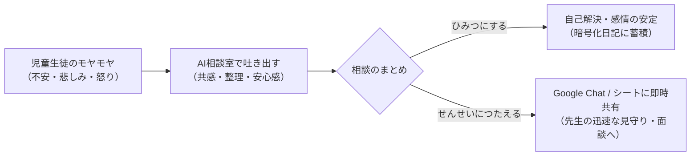

# 『こころの相談室』教師用機能説明・運用マニュアル

本書は、小学校・中学校・特別支援学校等の現場において、担任・養護教諭・スクールカウンセラー（SC）・管理職の先生方が『こころの相談室』を安心・安全に運用するためのガイドラインです。

---

## 1. アプリの目的と学校現場での位置づけ

### 1.1 開発の思いと基本方針
「誰にも言えない悩み」「先生や親に心配をかけたくないという遠慮」「言葉にしづらいモヤモヤ」を抱える児童生徒に対し、**GIGAスクール端末（Chromebook / iPad等）からいつでも安全にアクセスできる心理的セーフティネット**を提供します。

* **AIパートナーの役割**: 医療・診断や最終的な問題解決ではなく、**「まずは100%肯定・共感して孤立を防ぎ、気持ちを整理する」**ための存在です。
* **先生方の役割**: AIが児童の言葉を受け止め、児童自身が「先生に伝えよう」と決心した時に、**そのSOSを迅速かつ温かくキャッチして現実の支援につなげる**役割を担います。

---

## 2. 児童生徒側の利用フローと画面説明

児童がどのような手順でアプリを利用しているかを理解しておくことで、面談時の声かけがスムーズになります。

### ステップ 1: はじめの約束（利用ルール確認）
* アプリ起動時、最初に「うそはつかなくていいよ」「ふわふわ言葉を使おうね」「AIだから間違うこともあるよ」「秘密は守るよ」という安心のための約束画面が表示されます。

### ステップ 2: 今日の気分の選択
* 「うれしい」「ふつう」「かなしい」「おこってる」「つかれた」「ドキドキ」「モヤモヤ」の7つのボタンから、今の気持ちを直感的に選びます。
* AIは選ばれた気分に寄り添った最初の言葉がけを行います。

### ステップ 3: チャットによる対話
* **文字入力またはマイク入力**: キーボードタイピングだけでなく、音声入力（マイク）にも対応しています。
* **まほうのメニュー（🪄えらぶ）**: 「どうすればいい？」「いっしょにかんがえて」など、気持ちを言葉にするのが苦手な低学年の子でもワンタップで会話を進められます。
* **アバターの表情連動**: 児童の発言内容とAIの感情に合わせて、25種類のアバター表情がリアルタイムに変化します。
* **安全制御**: 1回の相談は最大20往復までに制限されており、長時間の画面凝視や依存を防ぎます。

### ステップ 4: 終了と振り返り（にっきの保存）
* 相談が終わると、AIが会話の要約（50文字以内の優しいひらがな文章）を自動生成します。
* 児童は「おわりのきもち」（すっきりした、まだかなしい等）を選び、ひとことメモを残して日記に保存します。

### ステップ 5: 先生への共有選択（重要）
* 最後に必ず以下の2者択一を行います：
  1. **【🔒 ひみつにして おわる】**: 相談内容は児童自身の暗号化シートにのみ保存され、先生には通知されません。
  2. **【📢 せんせいにも つたえる】**: 「こうちょう先生」「ほけんの先生」「たんにんの先生」など、伝えたい先生を選択して終了します。

---

## 3. 教師側での確認と対応フロー

児童が「📢 せんせいにも つたえる」を選択した場合、以下の2つの経路で情報が届きます。

### 3.1 Google Chat スペースでの即時SOS通知（設定している場合）
* 児童が送信した瞬間、設定した職員用スペースに通知カードが届きます。
* **通知内容**:
  * 学年・組・出席番号・氏名
  * 相談要約（AIが客観的にまとめた200文字程度の概要）
  * 希望する担当教員（例：「ほけんのせんせい」等）
  * 管理スプレッドシートへの直接リンクボタン

### 3.2 教師用スプレッドシート（『児童より』シート）の確認
1. 『こころの相談室_教師用管理簿』を開きます。
2. シート『**児童より**』を選択します。
3. 新しい相談が最新行に自動追記されています：
   * **日時**: 相談が完了した日時
   * **児童情報**: 学年、組、番号、氏名、メールアドレス
   * **相談概要**: AIが生成した客観的な要約文（話題の中心、感情の推移）

---

## 4. 児童のプライバシー保護とセーフティ基準

### 4.1 暗号化によるプライバシー保護
* 児童一人ひとりの相談ログは、児童個別のスプレッドシートに **AES（軍事レベルの暗号化規格）** で暗号化されて保存されます。
* 児童が「ひみつにする」を選んだ相談内容は、Google Driveの管理者であっても平文で勝手に盗み見ることはできません。児童が「ここは安全な場所だ」と心から信頼して本音を話せる環境を担保しています。

### 4.2 命の危険や虐待に関する絶対安全ルール（AIのプロンプト制限）
AIには、以下のような厳格なセーフティガードレールが組み込まれています：

> [!IMPORTANT]
> **AIの安全制御ルール**
> 1. **希死念慮・自傷**: 命に関わる発言があった場合、絶対に方法の提示や安易な肯定をせず、児童の気持ちを温かく受け止めた上で「あなたのことが大切。信頼できる先生や大人に話そう」と優しく誘導します。
> 2. **虐待・性被害・深刻ないじめ**: AI自身が解決しようとせず、必ず先生への相談を促します。
> 3. **要約時のセンシティブ表現の抽象化**: 性的な事案や暴力などの過激な表現は、AIが「身体への不適切な接触」「深刻な家庭内トラブル」などの専門的・抽象的な表現に自動置換して記録します。

---

## 5. 学校現場での運用上のアドバイス

### 5.1 SOS通知を受け取った時の初期対応
1. **緊急度の判断**:
   * 要約を読み、生命・身体の危険（自傷、いじめ、虐待等）の兆候がないか迅速に確認します。
2. **指定された先生からの自然な声かけ**:
   * 児童が「ほけんの先生」を指名していた場合、まずは保健室の先生から「最近どう？少し話そうか」と自然に声をかけていただくのが効果的です。
3. **「相談室で書いてくれたんだね」と受け止める**:
   * 「AIから連絡があった」ではなく、「相談室で勇気を出して先生に伝えてくれてありがとう」と肯定的に受け止めてください。

### 5.2 「ひみつ」の相談に対する姿勢
* 児童が「ひみつ」を選んでいる相談について、大人が無理に聞き出そうとしたり、追及したりすることは避けてください。「自分だけの秘密の部屋」があること自体が、子どもの心のシェルター（避難場所）として機能します。
